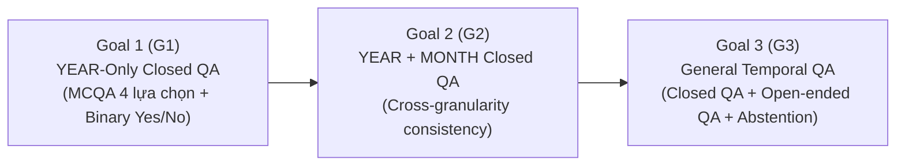

# Khung Mục Tiêu Nghiên Cứu Ba Tầng và Tiêu Chuẩn Nghiệm Thu Đo Lường (Goal Ladder G1 → G2 → G3)

## Tóm lược Quyết định Quản trị (Executive Summary)

Văn bản này thiết lập **Nguồn Chân lý Duy nhất (Single Source of Truth)** về mục tiêu nghiên cứu và tiêu chuẩn nghiệm thu đo lường của đề tài `long-range-temporal-alignment`, do Người dùng (Chủ nhiệm nghiên cứu) xác lập vào ngày 05/11/2026 với sự đồng thuận phương pháp luận từ ChatGPT.

Quyết định này **chính thức thay thế (supersede)** quan điểm trước đây tại [[Decision-Making/19_STAGE03_REPRESENTATION_FIRST_CONTRACT|DECISION-STAGE03-REPRESENTATION-FIRST-108]] vốn chỉ coi trắc nghiệm đóng là phép thăm dò phụ (behavioral probe) và ưu tiên khoảng cách biểu diễn hình học. Theo mục tiêu mới, **độ chính xác nội dung câu trả lời thời gian đóng (closed-answer temporal correctness) là kết quả đo lường bắt buộc** của Goal 1.

---

## 1. Dải Mục Tiêu Nghiên Cứu (Goal Ladder Specification)

Dải mục tiêu tuân thủ quan hệ bao hàm năng lực và độ hạt thời gian: $G_1 \subset G_2 \subset G_3$. Đây là lộ trình mở rộng quy mô năng lực khoa học, không đồng nghĩa mọi mô hình thành phần đều tăng trưởng đơn điệu trên mọi lát cắt.

### 1.1. GOAL 1 (G1) — YEAR-only Closed-Answer Temporal QA (Phạm vi hiện hành)
- **Tôn chỉ khoa học**: Cải thiện đồng thời năng lực nhận diện thời gian (temporal recognition) và suy luận trật tự thời gian (temporal reasoning) khi câu hỏi mang độ hạt mốc **NĂM LỊCH SỬ (YEAR)**.
- **Định dạng câu trả lời bắt buộc**:
  1. Trắc nghiệm 4 lựa chọn đối kháng: `A / B / C / D`;
  2. Câu hỏi quan hệ trật tự nhị phân: `Yes / No`.
- **Nguyên tắc nghiệm thu chân lý**: Bắt buộc đo đáp án **đúng nội dung và đúng niên đại lịch sử**, không chấp nhận việc chỉ làm biến đổi khoảng cách vector embedding hay biên độ logit làm chỉ số nghiệm thu đầu ra.
- **Bộ thước đo mục tiêu cốt lõi (Target Metrics)**:
  - Canonical Accuracy (đo trên cấu hình nguyên bản của đề thi);
  - Debiased Mean Accuracy (trung bình qua các cấu hình hoán vị vị trí);
  - Strict Accuracy (chính xác tuyệt đối $4/4$ vòng hoán vị cho câu hỏi 4 lựa chọn, và $2/2$ cấu hình đảo vị trí Yes/No cho câu hỏi nhị phân);
  - Báo cáo phân rã độc lập theo từng dạng câu hỏi (MCQA và Binary tách biệt), kèm theo điểm tổng hợp bình quân gia quyền.
- **Thước đo độ bền vững (Robustness Metrics)**:
  - Tỷ lệ đúng cả hai câu trong cặp phản thực nghiệm đảo năm có chứng thực pháp lý (Grounded Counterfactuals Both-Correct Rate);
  - Tỷ lệ bảo toàn tri thức nền (Retention Rate) đối với năng lực ngôn ngữ tiền huấn luyện.
- **Thước đo chẩn đoán cơ chế (Diagnostic Only - Không dùng làm mục tiêu nghiệm thu)**:
  - Biên độ dịch chuyển logit thời gian ($\Delta \text{logits}$);
  - Hiện tượng va chạm tần số FoNE (FoNE collision rate);
  - Khoảng cách hình học biểu diễn ($D_z, D_F, D_W$).
- **Hiện trạng dữ liệu & Ranh giới bằng chứng**:
  - Tập huấn luyện: `train_104k_clean.jsonl.gz` ($104.130$ mẫu);
  - Tập kiểm chuẩn: `eval_5292_clean.jsonl.gz` ($5.292$ mẫu). Tập dữ liệu này đã được sử dụng nhiều lần để lựa chọn mô hình trong Stage 03 nên được phân loại chuẩn tắc là **Development Benchmark**, chưa phải tập kiểm tra độc lập nguyên vẹn (Untouched Test Split).
  - Trạng thái hiện tại: `ACTIVE_CURRENT_SCOPE / QUARANTINED_PENDING_PROVENANCE`. Các số đo 5 epochs đạt trạng thái `METRIC_ARITHMETIC_ONLY`, duy trì lệnh `HOLD_NO_GO_TRAINING` cho đến khi vượt qua cổng Replay trên GPU với mẫu đại diện.

### 1.2. GOAL 2 (G2) — YEAR + MONTH Closed-Answer Temporal QA (Mở rộng kế tiếp)
- **Tôn chỉ khoa học**: Bảo toàn trọn vẹn toàn bộ các tiêu chuẩn của G1, đồng thời mở rộng độ hạt thời gian sang hai cấp độ kết hợp: **NĂM và THÁNG (YEAR + MONTH)**.
- **Định dạng câu trả lời**: Duy trì trắc nghiệm 4 lựa chọn `A/B/C/D` và nhị phân `Yes/No`.
- **Ràng buộc đánh giá**:
  - Mặt nạ phân giải độ hạt thời gian (temporal precision/granularity mask);
  - Chuẩn hóa biểu thức thời gian có truy xuất nguồn gốc (provenance-backed normalization);
  - Triệt tiêu hoàn toàn ảo giác tháng (no-hallucinated-month);
  - Tính nhất quán xuyên độ hạt (cross-granularity consistency: một sự kiện xảy ra vào tháng 05/1954 phải suy ra xảy ra trong năm 1954).
- **Yêu cầu dữ liệu**: Thiết kế tệp dữ liệu tháng có chứng thực nguồn gốc trước khi tiến hành thực nghiệm. Không suy diễn từ dữ liệu chỉ có năm.
- **Trạng thái hiện tại**: `NEXT_SCOPED_GOAL / NOT_YET_MEASURED` (Chưa triển khai đo đạc, không gắn nhãn hoàn thành).

### 1.3. GOAL 3 (G3) — General Temporal QA (Mục tiêu tối thượng)
- **Tôn chỉ khoa học**: Giữ vững năng lực của G1 và G2, mở rộng sang năng lực nhận diện, truy hồi và sử dụng dữ kiện lịch sử để trả lời câu hỏi tự do (**Open-Ended QA**) bên cạnh các câu hỏi đóng, đặt trong bối cảnh lịch sử Việt Nam.
- **Định dạng câu trả lời**: Câu trả lời đóng (`MCQA`, `Yes/No`) kết hợp câu trả lời dạng văn bản tự do có dẫn chứng (Evidence-grounded text generation) và năng lực từ chối trả lời (Abstention) khi thiếu bằng chứng xác thực.
- **Thước đo nghiệm thu**:
  - Exact Match (EM) và F1-score so với văn bản căn cứ lịch sử;
  - Độ chính xác sự kiện thời gian (Factual & Temporal Correctness);
  - Tỷ lệ gán sai mốc thời gian (Wrong-Time Rate);
  - Tỷ lệ từ chối hợp lệ khi dữ kiện không đủ (Valid Abstention Rate);
  - Tỷ lệ duy trì năng lực cũ qua các năm/tháng (Year/Month Retention).
- **Phân định phương tiện kỹ thuật**: G3 là mục tiêu đầu ra năng lực, không đồng nhất với việc bắt buộc phải dùng mô hình khổng lồ hay bắt buộc phải tích hợp RAG nếu phương pháp nội tại chứng minh hiệu quả hơn.
- **Trạng thái hiện tại**: `ULTIMATE_RESEARCH_GOAL / TARGET_NOT_ACHIEVED`.

---

## 2. Hệ Thống Phân Định Thực Thể Quản Trị Nghiên Cứu

Để tránh nhầm lẫn giữa mục tiêu khoa học, phương pháp tiếp cận và tiến trình triển khai thực tế, dự án quy định nghiêm ngặt 6 định danh phân tầng:

| Khái niệm Định danh | Ký hiệu Chuẩn | Bản chất Quản trị | Ví dụ trong Dự án |
| :--- | :---: | :--- | :--- |
| **Mục Tiêu Nghiên Cứu** | `GOAL_ID` | Định nghĩa năng lực đầu ra và tiêu chuẩn nghiệm thu | `G1`, `G2`, `G3` |
| **Nhánh Phương Pháp** | `TRACK_ID` | Cơ chế kỹ thuật can thiệp độc lập | `track-a` (Truy xuất bên ngoài), `track-b` (Biểu diễn nội tại) |
| **Không Gian Nhánh Git** | `BRANCH_ID` | Không gian làm việc có lịch sử mã nguồn và quyền ghi | `v1-dual-cycle-mat-lora`, `v2-targeted-continual-alignment` |
| **Chặng Triển Khai** | `STAGE_ID` | Mốc lịch sử phát triển có chứng từ niêm phong | `Stage 01`, `Stage 02`, `Stage 03` |
| **Nhánh Thực Nghiệm** | `ARM_ID` | Biến thể cấu trúc / hàm mất mát trong một thử nghiệm | `Arm 1` (Baseline), `Arm 2` (MaT-LoRA), `Arm 4` (Static), `Arm 5` (Hợp nhất) |
| **Lần Thực Thi Máy** | `RUN_ID` | Phiên chạy máy tính có mã băm bất biến và biên nhận chi phí | `ap-cNkSe2hf7vevvC9KjH1twj`, `Kernel ID 140550418` |

---

## 3. Bảng Khế Ước Chuyển Tiếp Cổng Kiểm Định (Transition Gates)

Mỗi giai đoạn chuyển tiếp giữa các mục tiêu bắt buộc phải vượt qua các cổng kiểm định tối thiểu:

1. **Cổng G1-Replay (`G1_RUN_AND_REPLAY`)**:
   - Tái lập suy luận xác định trên tập 128 mẫu phân tầng (`REPLAY_SAMPLE_MANIFEST.json`) với mô hình nền `Qwen2.5-3B` và trọng số adapter Stage 03;
   - So khớp phân phối logit thô và nhãn dự đoán;
   - Ngân sách tối đa không vượt quá \$0.20 USD trên 1x GPU A10G; cần phê duyệt tường minh từ User + ChatGPT trước khi khởi chạy.
2. **Cổng G1-Test (`G1_INDEPENDENT_TEST`)**:
   - Xây dựng tập kiểm chuẩn độc lập $N=2.000$ mẫu tách rời thực thể (entity-disjoint) và mở rộng niên đại 2023-2025;
   - Cân bằng cấu trúc phản thực nghiệm (50% Yes->No, 50% No->Yes).
3. **Cổng Chuyển Tiếp G1 → G2 (`G2_DATA_READY`)**:
   - Thu thập và chuẩn hóa dữ liệu lịch sử có nhãn tháng được kiểm định pháp lý;
   - Xác lập hợp đồng mặt nạ độ hạt thời gian.
4. **Cổng Chuyển Tiếp G2 → G3 (`G3_OPENQA_READY`)**:
   - Xây dựng bộ quy tắc đánh giá câu hỏi mở tiếng Việt kèm căn cứ bằng chứng và cơ chế từ chối khi thiếu dữ liệu.

---

## 4. Quyết định Điều phối Hệ thống
1. Thiết lập `ACTIVE_BRANCH=GLOBAL_MAINTENANCE` để cập nhật các chính sách chung.
2. Bảo toàn tuyệt đối các tệp kết quả thô, tệp JSON và biên nhận lịch sử tại `Reports/6-11Report/` và `Documents/Documenting/`.
3. Duy trì lệnh cấm huấn luyện GPU mới (`NO_GO_TRAINING`) cho đến khi có quyết định bằng văn bản từ Người dùng và ChatGPT.
