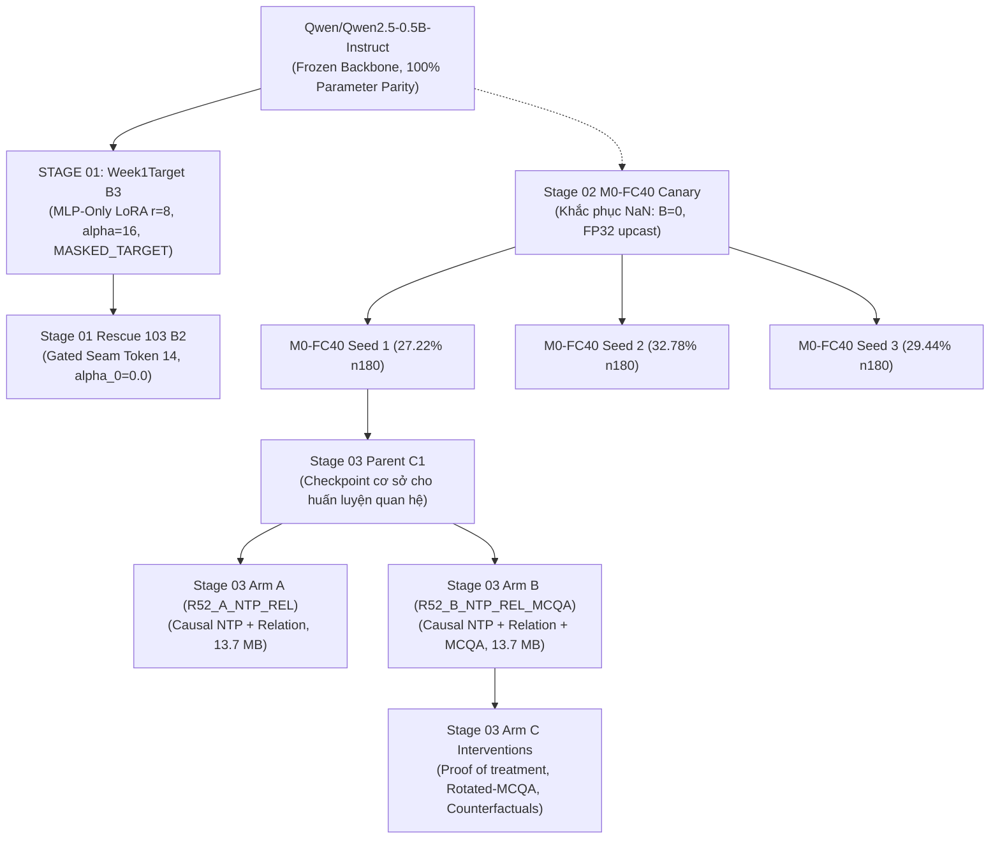

# Dòng Phả Hệ và Tính Tương Thích Giao Thức Đánh Giá (Lineage and Protocol Compatibility)

Tài liệu này phân tích dòng phả hệ phát triển mô hình, sự biến đổi của các tập dữ liệu, và nguyên nhân dẫn đến sự dịch chuyển số liệu (Evaluation Contract Shift) giữa các giai đoạn của đề tài.

---

## 1. Dòng Phả Hệ Mô Hình và Trọng Số (Model Lineage)

Dòng phả hệ của các mô hình trong đề tài được truy vết liên tục từ mô hình nền đóng băng ban đầu đến các biến thể thích ứng tham số:

*Lưu ý phả hệ:* Ba hạt giống M0-FC40 (Seed 1, 2, 3) được huấn luyện **song song độc lập** từ cùng mô hình nền Qwen-0.5B đóng băng sau bản vá Canary, không kế thừa tuần tự từ nhau.

---

## 2. Tiến Hóa Của Giao Thức Đánh Giá (Evaluation Protocols: P00 – P12)

Bài học pháp y quan trọng nhất của đề tài là **hiện tượng dịch chuyển khế ước đánh giá (Evaluation Contract Shift)**: sự thay đổi trong định dạng lời nhắc (prompt formatting) hoặc bộ phân tích chuỗi sinh (parser) làm thay đổi hoàn toàn điểm số trên cùng một tập trọng số checkpoint.

| Mã giao thức | Định dạng lời nhắc (Prompt Formatting) | Bộ phân tích cú pháp (Parser Logic) | Phạm vi áp dụng | Đặc điểm kỹ thuật & Giới hạn |
|---|---|---|---|---|
| **$P_{00}$** | Raw prompt không có ChatML template | Naive regex `[A-D]` | Baseline thô ban đầu | Mô hình Instruct không nhận diện được ngữ cảnh hội thoại, sinh chuỗi rỗng `''`. |
| **$P_{01}$** | ChatML template chuẩn của Qwen | Naive regex `[A-D]` | Thử nghiệm sơ khởi Stage 02 | Bỏ sót các nhãn chữ thường `a,b,c,d` của TempUN Small, ép các câu đúng thành Invalid. |
| **$P_{10}$** | ChatML template có phân loại task | Naive regex `[A-D]` | Thử nghiệm chẩn đoán | Tách câu hỏi nhưng vẫn gặp lỗi parser nhãn chữ thường. |
| **$P_{11}$** | ChatML template thêm chuỗi `'or Yes/No'` | Partner regex parser | Baseline liên kết đối tác | Chuỗi `'or Yes/No'` gây nhiễu tiên nghiệm: logits 'Yes'/'No' chiếm $66.4\%$ trên câu MCQA. |
| **$P_{12}$** | **Task-Aware ChatML chuẩn tắc** (tách riêng MCQA 4 lựa chọn và Yes/No) | **Task-Conditioned Strict Case-Insensitive Parser** | **Giao thức chuẩn Stage 02 & Stage 03** | Loại bỏ hoàn toàn nhiễu tiên nghiệm, nhận diện đúng cả chữ hoa và chữ thường, Invalid Rate $= 0.0\%$. |

---

## 3. Ma Trận Tương Thích Số Liệu và Phân Giải Sai Lệch

| Vấn đề đối chiếu | Khẳng định sơ thảo cũ | Sự thật kiểm toán xác thực | Nguyên nhân gốc rễ và Hướng xử lý |
|---|---|---|---|
| **Stage 01 2x2 Factorial** | B1: 35%/18% inv, B2: 39%/0% inv, B3: 31%/0% inv | B1: 13.15%/48.15% inv, B1M: 16.11%/47.59% inv, B2: 19.07%/42.04% inv, B3: 20.93%/40.19% inv | Nhầm lẫn giữa F0 baseline invalid rate ($38.89\%$) và overlap-prone slice đơn seed. Đã thay thế bằng bảng 3-seed chuẩn từ `01_factorial_2x2_results.json`. Cắt giảm tham số là $24.58\%$, không phải $57\%$. Tương tác âm nhẹ ($-1.11\text{ pp}$). |
| **Stage 01 FoNE McNemar** | p < 0.05 trên cả 3 seed | p < 0.05 trên **2/3 seeds** (Seed 1: $p=0.0104$, Seed 2: $p=0.0101$) | Đã hiệu chỉnh; khu biệt kết luận âm bản cho phương pháp cộng thô (additive FoNE setup). |
| **Stage 02 N24 vs N180** | M0-FC40 đạt 37.50% ± 4.17% trên full 180 câu | $37.50\% \pm 4.17\%$ là kết quả trên **$n=24$ mẫu** ($10/24, 9/24, 8/24$). Full 180 câu thực tế đạt **$29.81\% \pm 2.80\%$**. | $37.50\%$ của 180 là $67.5$ câu (bất khả thi về mặt số học). Đã phục hồi dữ liệu đo thực tế từ `09_statistics_and_slices.json` ($49/180, 59/180, 53/180$). Chênh lệch vs Base ($32.22\%$): $\Delta = -2.41\text{ pp}$ ($p > 0.05$, Inconclusive). |
| **Stage 02 Loader Bypass** | M0-FC40 trùng điểm 32.22% cả 3 seed | Script cũ tìm sai key `adapted_modules` thay vì `adapters_state`, dẫn đến chạy Base model | Bộ nạp chuẩn tắc `load_m0_fc40_for_inference` đã khắc phục; đo lại đúng $29.81\% \pm 2.80\%$. |
| **Stage 03 Denominators** | DEV Rel $n=60$, DEV MCQA $n=40$ | DEV Rel **$n=482$**, DEV MCQA **$n=120$** | Nhầm lẫn văn bản với pilot batch. File thực tế trên đĩa: DEV Rel 482 câu, Arm B đạt $62.03\%$; DEV MCQA 120 câu, Arm B đạt $50.83\%$. |
| **Stage 03 C_WRONG_YEAR** | Biến thiên $\Delta=0.0$, miễn nhiễm năm sai | Caller cũ truyền nhầm tọa độ năm thật. Sau khi sửa caller, biến thiên logit thực tế đạt **$0.118655$** ($4/36$ flips) | Phá vỡ hoàn toàn nghi vấn pseudo-immunity; khẳng định can thiệp thời gian hoạt động thực chất (`TREATMENT_VERIFIED`). |
| **Stage 03 Label Collapse** | Arm B có năng lực trắc nghiệm $24.44\%$ | Phép kiểm hoán vị phương án (Rotated MCQA) trên 624 biến thể đạt Semantic Consistency **$0.00\%$ ($0/156$)** | Mô hình thiên lệch áp đảo về nhãn chữ cái `b` ($78.2\%$) và `a` ($19.6\%$), khai thác shortcut vị trí thay vì suy luận ngữ nghĩa (`LABEL_COLLAPSE_CONFIRMED`). |

---

## 4. Nguyên Tắc Khoa Học Rút Ra

1. **Tính bất biến của khế ước đánh giá:** Tuyệt đối không so sánh ghép cặp trực tiếp khi có sự thay đổi về định dạng prompt, tokenizer, hoặc logic bộ phân tích cú pháp.
2. **Kiểm tra tính toàn vẹn bộ nạp (Loader Integrity):** Mọi script nạp checkpoint bắt buộc phải kiểm tra sự tồn tại của trọng số và giá trị gradient/alpha khác 0 để tránh hiện tượng chạy nhầm mô hình nền.
3. **Phân rã lát cắt dữ liệu minh bạch:** Mọi báo cáo bắt buộc phải phân định rạch ròi giữa các tập mẫu rò rỉ (`seen_source`) và tập mẫu không trùng lặp nguồn (`source_nonoverlap`).
4. **Kiểm tra tính bất biến ngữ nghĩa (Semantic Robustness):** Mọi tuyên bố về năng lực trắc nghiệm phải vượt qua bài kiểm tra hoán vị phương án trước khi kết luận mô hình có năng lực suy luận.
