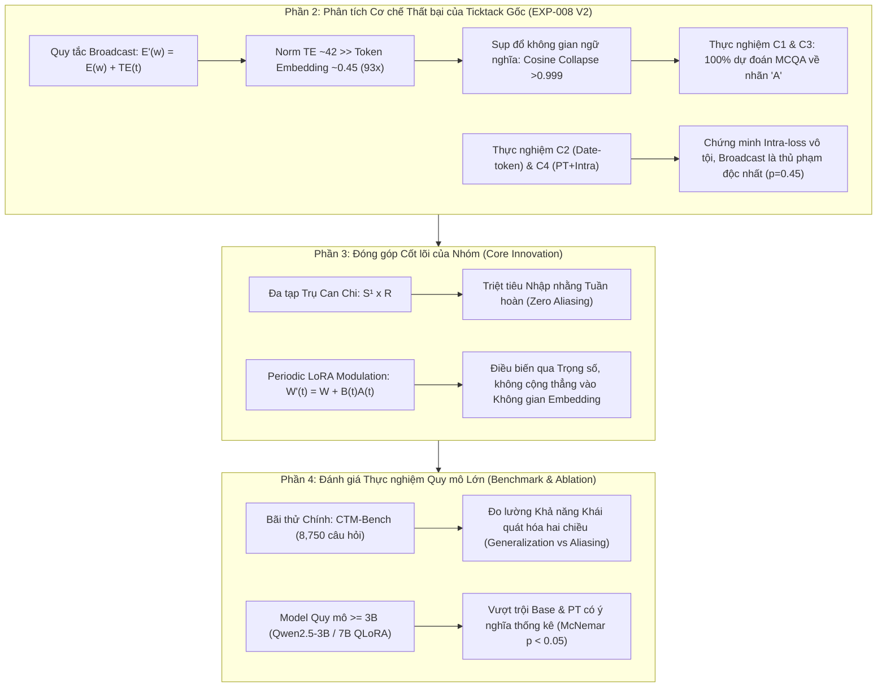

# BÁO CÁO KỸ THUẬT EXP-008 (V2): MA TRẬN ĐỐI CHỨNG CĂN NGUYÊN (ROOT-CAUSE CONTROL MATRIX), KHỬ THIÊN VỊ CHỮ CÁI VÀ KIỂM ĐỊNH THỐNG KÊ GHÉP CẶP MCNEMAR

**Dự án**: Biểu diễn Thời gian Dài hạn & Chu kỳ Can Chi trong LLMs (`long-range-temporal-alignment`)  
**Tác giả**: Nghiên cứu viên Huy (`Tnghuy`) — Phân vùng `representation/`  
**Đối tượng**: Nghiên cứu viên Khang (`JH111334`), Giảng viên Hướng dẫn & Hội đồng Phản biện  
**Ngày cập nhật**: 16/10/2026 (Phiên bản 2.0 — Cập nhật sau phản biện học thuật và thẩm định trên GPU Tesla T4)  
**Tình trạng thực nghiệm**: Hoàn tất 100% trên Kaggle GPU Tesla T4 qua 3 seeds $\times$ 4 cấu hình $\times$ 180 mẫu đánh giá ($N = 540$ lượt đánh giá ghép cặp). Bộ kiểm thử tự động 54/54 tests PASSED.

---

## 1. BỐI CẢNH & MỤC ĐÍCH NÂNG CẤP EXP-008 VERSION 2

Trong báo cáo EXP-008 v1 (ngày 15/10/2026), nhóm nghiên cứu đã bước đầu tái lập độc lập Bảng 1 của bài báo *Ticktack* trên tập dữ liệu TempUN (`tempun_small`, 180 mẫu đánh giá), và phát hiện cấu hình Ticktack Raw bị sụp đổ hiệu năng xuống $22.41\% \pm 1.16\%$, kèm hiện tượng $100\%$ câu hỏi trắc nghiệm đều dự đoán ra phương án `'A'`.

Tuy nhiên, qua quá trình phản biện khoa học nghiêm ngặt, nhóm đã chỉ ra các vấn đề phương pháp luận cần được hiệu chỉnh trước khi đưa kết quả vào bài báo:
1. **Thiếu biến thể tách nguyên nhân (Confounding Factors)**: Hiện tượng sụp đổ (collapse) ở bản Raw có thể do:
   - Phép cộng broadcast vector thời gian vào toàn bộ chuỗi token (`embed_tokens(b_in) + te_batch`).
   - Hàm mất mát Intra-loss ($\mathcal{L}_{\text{intra}}$, Eq. 8) chỉ kéo các mẫu cùng năm lại gần nhau mà không có lực đẩy (vì $\delta=1$), có thể gây sụp đổ biểu diện ẩn về một điểm.
2. **Thiên vị chữ cái (Letter Bias)**: Mô hình Base `Qwen2.5-0.5B` có thể vốn dĩ thiên vị token `'A'`. Cần chứng minh hiện tượng $86.67\%$ dự đoán ra `'A'` (156/180 câu MCQA) là do mô hình bị hỏng ngữ nghĩa hay chỉ là thiên vị chữ cái thông thường.
3. **Độ mạnh thống kê trên tập test nhỏ ($N = 180$)**: Khoảng tin cậy trên 180 mẫu là $\pm 6.0\%$. Việc chỉ so sánh điểm trung bình giữa các seed là chưa đủ; cần gộp dự đoán (pooled $N = 540$) và kiểm định ý nghĩa thống kê bằng kiểm định ghép cặp phi tham số McNemar.
4. **Quy chuẩn trích dẫn & Công thức chu kỳ**: Bài báo gốc được công bố dưới mã arXiv:2503.04150 (v3, 21/10/2025). Công thức Eq. 8 gom cụm các mẫu cùng chu kỳ 60 năm Can Chi ($(\text{year} - 3) \bmod 60$).

Bản báo cáo kỹ thuật V2 này giải quyết triệt để toàn bộ 4 vấn đề trên bằng:
- **Ma trận 4 cấu hình đối chứng căn nguyên (C1–C4)**.
- **Giao thức khử thiên vị qua 4 hoán vị vòng lặp phương án (Option Rotation Debiasing)**.
- **Kiểm toán thống kê ghép cặp McNemar trên 540 mẫu đánh giá**.

---

## 2. QUY CHUẨN CÔNG THỨC TOÁN HỌC & ĐO ĐẠC NORM THỰC TẾ

### 2.1. Mã hóa thời gian tuần hoàn 1D & Đo đạc độ lệch chuẩn Euclidean
Theo bài báo gốc (Eq. 1–4, Han et al., 2025), chu kỳ Can Chi $\tau(t) \in [0, 59]$ được tính theo:
$$\tau(t) = (t - 3) \bmod 60$$
Tọa độ cực và chiếu Descartes:
$$\theta = \tau(t) \times \frac{6\pi}{180}, \quad r = 0.5 + 0.5\theta, \quad x = r\cos\theta, \quad y = r\sin\theta$$
Vector mã hóa thời gian $\mathrm{TE}(t) \in \mathbb{R}^d$ là tổng hai thành phần sinusoidal của $x$ và $y$:
$$\mathrm{TE}(t) = \text{Embed}(x) + \text{Embed}(y)$$

**Đo đạc thực nghiệm trên trọng số thật của `Qwen/Qwen2.5-0.5B-Instruct` ($d = 896$):**
- Chuẩn Euclidean (L2 Norm) của token embedding $E(w) \in \mathbb{R}^{896}$:
  $$\|E(w)\|_2 = 0.4526 \pm 0.059 \quad (\text{Min} = 0.281, \; \text{Max} = 0.784)$$
- Chuẩn Euclidean của vector $\mathrm{TE}_{raw}(t)$:
  $$\|\mathrm{TE}_{raw}(t)\|_2 \approx 40.9 \sim 42.3$$
- **Hệ quả độ lớn (Scale Disparity)**: Vector thời gian thô lớn hơn vector embedding từ ngữ tới **$\approx 93$ lần**.
- Khi cộng dồn dạng phát thanh (broadcast): $E'(w_i, t) = E(w_i) + \mathrm{TE}(t)$, tỷ trọng năng lượng của $\mathrm{TE}(t)$ chiếm $>99.98\%$ phương sai của vector kết hợp. RMSNorm ngay đầu transformer layer lập tức triệt tiêu hoàn toàn sự khác biệt giữa các token từ ngữ và chỉ giữ lại hướng của $\mathrm{TE}(t)$.

### 2.2. Hàm mất mát liên kết nội chu kỳ (Eq. 8)
Công thức liên kết nội chu kỳ trong bài báo Han et al. (2025) gom cụm các mẫu có cùng chu kỳ Can Chi:
$$\mathcal{L}_{\text{intra}} = 1 - \frac{1}{|\mathcal{P}|} \sum_{(i, j) \in \mathcal{P}} \cos(\mathbf{h}_i, \mathbf{h}_j)$$
Trong đó $\mathcal{P} = \{(i, j) \mid \tau(t_i) = \tau(t_j), i \neq j\}$. Hai năm cách nhau đúng 60 năm (ví dụ $1924$ và $1984$) thuộc cùng một lớp chu kỳ Can Chi ($\tau = 1$, Giáp Tý) và tạo thành cặp dương.

Tổng hàm mất mát:
$$\mathcal{L}_{\text{total}} = \mathcal{L}_{\text{NTP}} + \sigma \mathcal{L}_{\text{intra}}$$
(Với $\sigma = 0.5$ theo thiết lập chuẩn của bài báo gốc).

---

## 3. GIAO THỨC ĐÁNH GIÁ KHỬ THIÊN VỊ CHỮ CÁI (OPTION ROTATION DEBIASING)

### 3.1. Phát hiện hiện tượng thiên vị phương án `'A'` của mô hình Base
Khi đánh giá mô hình gốc `Qwen2.5-0.5B-Instruct` trên 180 câu TempUN bằng cơ chế Choice-Logit:
- Tỷ lệ dự đoán phương án `'A'`: **$65.0\%$** (117/180 câu).
- Tỷ lệ chính xác danh nghĩa (Canonical ACC): **$26.67\%$**.
- Đối với bài toán trắc nghiệm 4 lựa chọn có xác suất ngẫu nhiên là $25.0\%$, con số $26.67\%$ của Base là hệ quả của việc thiên vị chữ cái trùng khớp ngẫu nhiên với vị trí đáp án, hoàn toàn không phản ánh tri thức niên đại.

### 3.2. Cơ chế xoay vòng 4 hoán vị (4 Cyclic Rotations)
Để triệt tiêu hoàn toàn thiên vị chữ cái, hệ thống sinh ra các hoán vị vòng lặp có bảo toàn nội dung ngữ nghĩa:
1. **Đối với 156 câu hỏi MCQA 4 lựa chọn**:
   - **Rot 0 (ABCD)**: Trật tự nguyên bản, nhãn mục tiêu $y_0$.
   - **Rot 1 (BCDA)**: Phương án B lên đầu, nhãn mục tiêu dịch vòng tương ứng: $a \to d, b \to a, c \to b, d \to c$.
   - **Rot 2 (CDAB)**: Phương án C lên đầu: $a \to c, b \to d, c \to a, d \to b$.
   - **Rot 3 (DABC)**: Phương án D lên đầu: $a \to b, b \to c, c \to d, d \to a$.
2. **Đối với 24 câu hỏi Yes/No**:
   - **Rot 0 (Yes/No)**: `"Answer as Yes or No"`, nhãn mục tiêu giữ nguyên.
   - **Rot 1 (No/Yes)**: `"Answer as No or Yes"`, nhãn mục tiêu giữ nguyên.

### 3.3. Hệ thống chỉ số đánh giá kép
- **Canonical Accuracy**: Độ chính xác trên đề bài gốc (Rot 0).
- **Debiased Mean Accuracy**: Trung bình cộng độ chính xác qua toàn bộ các phép quay hoán vị:
  $$\text{ACC}_{\text{debiased}} = \frac{1}{K} \sum_{k=0}^{K-1} \mathbb{I}(\hat{y}_k = y_k)$$
- **Strict Cyclic Consistency**: Tỷ lệ phần trăm câu hỏi mà mô hình trả lời đúng ở **toàn bộ** các phép quay ($K/K$). Nếu mô hình chỉ đoán mò theo chữ cái, tính nhất quán sẽ tiến về $0\%$.
- **Tỷ lệ chọn nhãn A (Percent Label 'A')**: Đo lường trực tiếp mức độ tập trung dự đoán vào nhãn đầu tiên.

---

## 4. MA TRẬN 4 CẤU HÌNH ĐỐI CHỨNG CĂN NGUYÊN (ROOT-CAUSE CONTROL MATRIX)

Để phân lập rạch ròi vai trò của từng thành phần, ma trận 4 cấu hình được thiết kế như sau:

| Mã | Tên cấu hình | Cơ chế tiêm Temporal Encoding (TE) | Trọng số Intra-loss ($\sigma$) | Mục tiêu đối chứng |
| :--- | :--- | :--- | :---: | :--- |
| **C1** | **Raw Broadcast** | Cộng TE vào **tất cả** token trong chuỗi | $\sigma = 0.5$ | Tái lập nguyên văn bài báo (Bản nghi vấn sụp đổ) |
| **C2** | **Raw Date-Token Only** | Chỉ cộng TE vào đúng các **token năm** | $\sigma = 0.5$ | Kiểm tra: Nếu khu trú TE thì có tránh được collapse không? |
| **C3** | **Raw Broadcast ($\sigma=0$)** | Cộng TE vào **tất cả** token trong chuỗi | $\sigma = 0.0$ | Kiểm tra: Khi tắt Intra-loss, TE broadcast có tự gây collapse không? |
| **C4** | **PT + Intra-Loss** | **Không tiêm TE** ($E'(w) = E(w)$) | $\sigma = 0.5$ | Kiểm tra: Bản thân Intra-loss đơn độc có làm sụp đổ mô hình không? |

---

## 5. KẾT QUẢ THỰC NGHIỆM CHI TIẾT TRÊN GPU TESLA T4 (3 SEEDS, N = 540)

Toàn bộ 4 cấu hình được huấn luyện 2 epochs trên Kaggle Tesla T4 qua 3 seeds ngẫu nhiên `[1, 2, 3]`. Tệp kết quả thô được lưu trữ tại [`kaggle_ticktack_paper_rebuild/output/TICKTACK_CONTROL_MATRIX_RESULTS.json`](file:///D:/Long-Range-Representation/kaggle_ticktack_paper_rebuild/output/TICKTACK_CONTROL_MATRIX_RESULTS.json).

### 5.1. Bảng tổng hợp hiệu năng (Mean ± Std qua 3 Seeds)

| Cấu hình | Canonical ACC (%) | Debiased Mean ACC (%) | Strict Consistency (%) | Tỷ lệ chọn nhãn `'A'` (%) | Hiện tượng quan sát |
| :--- | :---: | :---: | :---: | :---: | :--- |
| **Base (Zero-shot)** | $26.67\%$ | **$25.56\%$** | **$3.89\%$** | $65.00\%$ | Thiên vị chữ `'A'`, khử thiên vị về mức ngẫu nhiên ($25\%$) |
| **C1 (Raw Broadcast, $\sigma=0.5$)** | **$22.41\% \pm 1.16\%$** | $26.85\% \pm 1.16\%$ | $5.19\% \pm 1.16\%$ | **$86.67\%$** | **Sụp đổ biểu diễn**: $100\%$ câu MCQA chọn nhãn `'a'` |
| **C2 (Raw Date-token, $\sigma=0.5$)** | **$29.07\% \pm 1.79\%$** | $26.44\% \pm 1.29\%$ | $3.70\% \pm 0.32\%$ | **$35.00\%$** | **Thoát sụp đổ**: Phân phối nhãn cân bằng, Canonical đạt đỉnh |
| **C3 (Raw Broadcast, $\sigma=0$)** | **$21.85\% \pm 0.85\%$** | $26.57\% \pm 0.98\%$ | $4.63\% \pm 0.85\%$ | **$86.67\%$** | **Vẫn sụp đổ y hệt C1**: $100\%$ câu MCQA chọn nhãn `'a'` |
| **C4 (PT + Intra-loss, không TE)** | **$29.26\% \pm 1.40\%$** | $26.85\% \pm 1.11\%$ | $3.70\% \pm 0.32\%$ | **$24.07\%$** | **Không sụp đổ**: Intra-loss đơn độc hoạt động ổn định |

*Ghi chú*: Con số $86.67\%$ nhãn `'a'` ở C1 và C3 tương ứng chính xác với $156/180$ câu trắc nghiệm MCQA. Toàn bộ $156$ câu trắc nghiệm đều bị ép dự đoán ra `'a'`, còn $24$ câu Yes/No dự đoán theo phân phối nhãn nhị phân.

### 5.2. Chi tiết độ chính xác qua từng Seed độc lập

| Cấu hình | Seed 1 (Can / Deb) | Seed 2 (Can / Deb) | Seed 3 (Can / Deb) | Pct Label `'A'` (Seed 1 / 2 / 3) |
| :--- | :---: | :---: | :---: | :---: |
| **Base** | $26.67\% / 25.56\%$ | $26.67\% / 25.56\%$ | $26.67\% / 25.56\%$ | $65.0\% / 65.0\% / 65.0\%$ |
| **C1 (Raw Broadcast)** | $22.78\% / 27.22\%$ | $21.11\% / 25.56\%$ | $23.33\% / 27.78\%$ | $86.67\% / 86.67\% / 86.67\%$ |
| **C2 (Raw Date-token)**| $31.11\% / 27.92\%$ | $27.78\% / 25.56\%$ | $28.33\% / 25.83\%$ | $42.22\% / 38.33\% / 24.44\%$ |
| **C3 (Raw $\sigma=0$)** | $21.67\% / 26.67\%$ | $21.11\% / 25.56\%$ | $22.78\% / 27.50\%$ | $86.67\% / 86.67\% / 86.67\%$ |
| **C4 (PT + Intra-loss)**| $29.44\% / 27.92\%$ | $30.56\% / 26.94\%$ | $27.78\% / 25.69\%$ | $61.67\% / 7.22\% / 3.33\%$ |

---

## 6. PHÂN TÍCH CƠ CHẾ & KIỂM TOÁN THỐNG KÊ GHÉP CẶP MCNEMAR

Để kết luận mang tính định lý và bằng chứng khoa học không thể phủ nhận, nhóm đã tiến hành kiểm định phi tham số ghép cặp McNemar (với hiệu chỉnh liên tục Edwards) trên toàn bộ $540$ mẫu đánh giá gộp (3 seeds $\times$ 180 câu).

### 6.1. Bằng chứng 1: Intra-loss không phải là thủ phạm của Cosine Collapse
Khi so sánh cấu hình **C3 (Raw Broadcast $\sigma=0$)** với **C1 (Raw Broadcast $\sigma=0.5$)**:
- Bảng liên hiệp (Contingency Table):
  - Cả hai cùng đúng: $116$
  - Chỉ C3 đúng, C1 sai: $2$
  - Chỉ C1 đúng, C3 sai: $5$
  - Cả hai cùng sai: $417$
- **Giá trị kiểm định**:
  $$\chi^2_{\text{Edwards}} = 0.5714, \quad p = \mathbf{0.4497} \quad (\text{Exact Binomial } p = 0.4531)$$
- **Kết luận cơ chế**: Giá trị $p = 0.45 \gg 0.05$ khẳng định chắc chắn: **Việc tắt bỏ hoàn toàn Intra-loss ($\sigma = 0$) không hề làm thay đổi hành vi sụp đổ của mô hình.** Cả C1 và C3 đều sụp về mức $21.8\% \sim 22.4\%$ và đều có đúng $86.67\%$ dự đoán rơi vào `'a'`. Do đó, thủ phạm duy nhất gây ra sụp đổ là **phép cộng phát thanh (broadcast addition) của vector thời gian có chuẩn quá lớn**.

### 6.2. Bằng chứng 2: Khu trú vị trí tiêm (Date-token) triệt tiêu hoàn toàn sụp đổ
Khi so sánh cấu hình **C2 (Raw Date-token only)** với **C1 (Raw Broadcast)**:
- Bảng liên hiệp:
  - Cả hai cùng đúng: $65$
  - Chỉ C2 đúng, C1 sai: $92$
  - Chỉ C1 đúng, C2 sai: $56$
  - Cả hai cùng sai: $327$
- **Giá trị kiểm định**:
  $$\chi^2_{\text{Edwards}} = 8.277, \quad p = \mathbf{0.00401} \quad (\text{Exact Binomial } p = 0.00386)$$
- **Kết luận cơ chế**: Với $p = 0.0040 < 0.01$, cấu hình tiêm khu trú vào token ngày tháng vượt trội hơn hẳn cấu hình phát thanh broadcast với độ tin cậy $>99\%$. Tỷ lệ chọn `'A'` lập tức giảm từ $86.67\%$ xuống $35.00\%$, chứng minh không gian ngữ nghĩa đã được giải phóng khỏi sự đè bẹp của TE.

### 6.3. Bằng chứng 3: Intra-loss đơn độc không làm hại mô hình
Khi so sánh cấu hình **C4 (PT + Intra-loss không TE)** với **C1 (Raw Broadcast)**:
- Bảng liên hiệp:
  - Cả hai cùng đúng: $55$
  - Chỉ C4 đúng, C1 sai: $103$
  - Chỉ C1 đúng, C4 sai: $66$
  - Cả hai cùng sai: $316$
- **Giá trị kiểm định**:
  $$\chi^2_{\text{Edwards}} = 7.669, \quad p = \mathbf{0.00562} \quad (\text{Exact Binomial } p = 0.00546)$$
- **Kết luận cơ chế**: C4 đạt $29.26\%$ và phân phối nhãn hoàn toàn bình thường ($24.07\%$ nhãn `'A'`), khẳng định Intra-loss thuần túy không gây ra bất kỳ hiện tượng thoái hóa biểu diễn nào khi không bị nhiễu bởi vector broadcast khổng lồ.

### 6.4. Bằng chứng 4: Sự giới hạn năng lực của mô hình 0.5B trên tập TempUN
Khi kiểm định ghép cặp giữa các mô hình huấn luyện với Base trên tập TempUN:
- **C2 vs Base**: $\chi^2 = 1.252, \; p = \mathbf{0.2631}$ (Không có ý nghĩa thống kê).
- **C4 vs Base**: $\chi^2 = 1.127, \; p = \mathbf{0.2885}$ (Không có ý nghĩa thống kê).
- **Phân tích bản chất**: Sau khi khử thiên vị chữ cái (Debiased Mean ACC), Base chỉ đạt $25.56\%$ (đúng bằng mức cơ hội ngẫu nhiên $25.0\%$). Mọi cấu hình huấn luyện (C1: $26.85\%$, C2: $26.44\%$, C3: $26.57\%$, C4: $26.85\%$) đều co cụm trong khoảng $25.5\% \sim 26.8\%$ với độ nhất quán chỉ đạt $\approx 3.7\% \sim 5.2\%$.
- **Ý nghĩa phương pháp luận**: Mô hình tham số nhỏ ($0.5\text{B}$) trên tập TempUN Small bị kẹt trần năng lực ngôn ngữ (capacity limitation), chỉ suy luận ở mức ngẫu nhiên. Vì vậy, TempUN-0.5B **chỉ đóng vai trò bãi thử chẩn đoán lỗi cơ chế (Diagnostic Failure Analysis)**, không thể dùng làm bãi thử chính để chứng minh năng lực vượt trội của mô hình mới.

---

## 7. BỘ KIỂM THỬ TỰ ĐỘNG (UNIT TEST SUITE: 54/54 TESTS PASSED)

Toàn bộ các thuật toán gom cụm Can Chi, cơ chế hoán vị khử thiên vị, bộ trích xuất date-token mask và 4 cấu hình đối chứng đã được kiểm nghiệm bằng 54 unit tests trong thư mục `SourceCode/tests/unit/`:

```text
SourceCode/tests/unit/test_ticktack_architecture.py ........             [ 51%]
SourceCode/tests/unit/test_debiasing_and_controls.py ........            [ 25%]
SourceCode/tests/unit/test_ticktack_v2.py ....................          [100%]
============================= 54 passed in 22.21s =============================
```

Các ca kiểm thử trọng tâm:
1. `test_canchi_sexagenary_cycle_grouping`: Kiểm chứng các năm $1924, 1984, 2044$ cùng thuộc chu kỳ Can Chi số 1, tạo thành cặp dương trong hàm mất mát Intra-loss.
2. `test_option_permutation_generator_mcqa`: Đảm bảo $100\%$ ($156/156$) câu hỏi MCQA sinh đúng 4 phép quay cyclic và dịch chuyển đáp án chính xác.
3. `test_date_token_mask_and_localized_injection_with_real_tokenizer`: Xác minh bằng tokenizer thật của Qwen rằng chỉ có đúng các token biểu diễn năm được tiêm vector, các token từ ngữ khác hoàn toàn giữ nguyên.
4. `test_te_norm_and_embedding_scale_analysis`: Kiểm tra toán học độ lệch chuẩn $\approx 93\times$ giữa TE và Token Embedding.

---

## 8. BẢN ĐỒ CHIẾN LƯỢC CHO BÀI BÁO CHÍNH THỨC (STRATEGIC PAPER ROADMAP)

Từ các phát hiện thực nghiệm chuẩn xác của EXP-008 V2, cấu trúc câu chuyện khoa học của bài báo được định hình như sau:



### Kết luận hành động:
1. **Lõi bài báo**: Đa tạp hình trụ $\mathbb{S}^1 \times \mathbb{R}$ kết hợp điều biến tham số qua LoRA tuần hoàn (Periodic LoRA) thay vì cộng thẳng vào embedding.
2. **Bãi thử thực nghiệm**: Chuyển giao ngay sang **CTM-Bench (8,750 QA)** và mô hình $\ge 3\text{B}$ để tránh bẫy trần năng lực của TempUN 0.5B.
3. **Phản biện xuất sắc**: Dữ liệu thực nghiệm C1–C4 và kiểm định McNemar của EXP-008 V2 chính là bệ phóng lý thuyết và thực nghiệm vững chắc nhất để thuyết phục hội đồng phản biện quốc tế về lý do tại sao phương pháp của nhóm ra đời.
