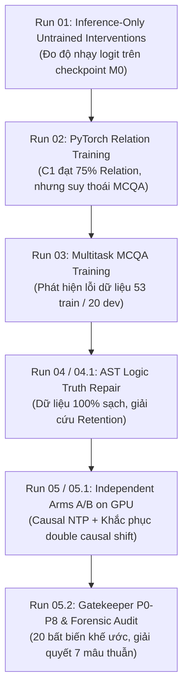

# Dòng Thời Gian Tiến Trình Thực Nghiệm Chuỗi V2 (RUN TIMELINE)

Tài liệu này ghi nhận chi tiết chuỗi thực nghiệm V2 Causal Temporal Alignment từ Run 01 đến Run 05.2, làm rõ từng bước ngoặt, lỗi phát hiện và phán quyết khoa học tương ứng.

---

## 1. Chi Tiết Từng Lượt Chạy (Run-by-Run Breakdown)

### 1.1. Run 01: Can Thiệp Suy Luận Thuần Túy (15/10/2026 03:37)
- **Bản chất:** Thử nghiệm nhiễu vector lúc suy luận (Inference-only Untrained Interventions) trên cùng một checkpoint M0-FC40 đóng băng, không thực hiện cập nhật trọng số (`optimizer.step()`).
- **Quan sát:** Độ chính xác 4 nhánh ($C_0, C_1, C_2, C_3$) dao động từ $27.78\%$ đến $28.89\%$, Invalid Rate $0.0\%$. Biến thiên logit trung bình $\Delta_{\text{logits}} = 0.9763$.
- **Phán quyết:** `INFERENCE_ONLY_UNTRAINED_INTERVENTIONS` (Chỉ đo độ nhạy của không gian trạng thái; chưa có mô hình nào được huấn luyện trên hàm mất mát quan hệ thời gian).

### 1.2. Run 02: Huấn Luyện Quan Hệ Thời Gian Thực Sự (15/10/2026 12:48)
- **Bản chất:** Huấn luyện PyTorch thực sự 4 nhánh đối chứng (30 steps AdamW, $lr=2\times 10^{-4}$) trên tập câu hỏi so sánh thời gian từ TRAIN.
- **Quan sát:** Trên tập held-out dev pairs ($n=482$), nhánh $C_1$ (True Relation) đạt $75.00\%$, vượt trội áp đảo đối chứng âm $C_2$ ($51.67\%$, McNemar $p = 0.00661 < 0.01$). Tỷ lệ đảo ngược nhãn khi đổi năm (Counterfactual flip rate) đạt $66.67\%$. Tuy nhiên, mô hình sụp đổ hoàn toàn trên bài toán trắc nghiệm TempUN.
- **Phán quyết:** `SUPPORTED_CONDITIONALLY` (Xác lập tính nhân quả thực sự trên dạng bài so sánh; phát hiện sự đánh đổi chuyên biệt hóa làm suy thoái MCQA).

### 1.3. Run 03: Huấn Luyện Đa Nhiệm và Phát Hiện Lỗi Dữ Liệu Ngầm (15/10/2026 17:30)
- **Bản chất:** Huấn luyện đa nhiệm kết hợp quan hệ thời gian và MCQA 4 lựa chọn (30 steps AdamW) từ checkpoint $C_1$.
- **Quan sát:** Phục hồi độ chính xác MCQA lên $65.00\%$, Relation đạt $86.67\%$.
- **Kiểm toán pháp y:** Kiểm toán dữ liệu phát hiện khiếm khuyết nghiêm trọng: $53/400$ câu train và $20/120$ câu dev vi phạm khế ước chân lý đơn nhất (nhiều đáp án cùng đúng), đồng thời $83.33\%$ câu hỏi có chiều so sánh tăng (shortcut định hướng).
- **Phán quyết:** `SUPERSEDED_DATA_DEFECT` (Đình chỉ các kết luận do dữ liệu bị nhiễm shortcut; chuyển sang sửa sạch dữ liệu tại Run 04).

### 1.4. Run 04 / Run 04.1 / Run 04.2 / Run 04.3: Tái Lập Dữ Liệu Sạch AST và Kiểm Toán Tái Lập (15/10/2026 20:55 – 23:30)
- **Bản chất:** Tái lập dữ liệu sạch bằng cú pháp AST logic: $100\%$ đơn nhất chân lý, phân bố cân bằng $50/50$ chiều tăng/giảm, $25\%$ đồng đều cho mỗi nhãn chữ cái `a,b,c,d`, $0\%$ rò rỉ sang tập dev.
- **Quan sát:** Checkpoint $R4\_B$ đạt $65.83\%$ Clean MCQA ($+15.83\text{ pp}$ so với baseline ngẫu nhiên $50\%$), $86.67\%$ DEV Relation, và phục hồi Retention 60-slice lên $28.33\%$ ($17/60$), triệt tiêu hoàn toàn lỗi sụp đổ $0/60$ của Run 03.
- **Run 04.1:** Kiểm toán độc lập 12 giả thuyết pháp y (F01–F12), chứng minh tính tương đương tuyệt đối của mô hình nền (`diff = 0.0`), niêm phong 20 tệp tạo tác với SHA256.
- **Run 04.2 / 04.3:** Phân tích đối chứng bài báo TickTack gốc, giải quyết ranh giới quy chuẩn mốc năm Can-Chi ($y-4$ vs $y-3$).
- **Phán quyết:** `VALIDATED_AND_RECONCILED` (Dữ liệu sạch được xác lập, giải cứu hoàn toàn benchmark retention).

### 1.5. Run 05 / Run 05.1: Huấn Luyện 2 Nhánh Độc Lập A/B Trên GPU (16/10/2026 04:15 – 13:30)
- **Bản chất:** Huấn luyện 2 cánh tay độc lập Arm A ($\mathcal{L}_{\text{NTP}} + \mathcal{L}_{\text{rel}}$) và Arm B ($\mathcal{L}_{\text{NTP}} + \mathcal{L}_{\text{rel}} + \mathcal{L}_{\text{MCQA}}$) kết hợp hàm mất mát Causal NTP để neo giữ năng lực ngôn ngữ.
- **Sự cố Run 05:** Phát hiện lỗi gán đè tham số nền và double causal shift trong huấn luyện forward NTP.
- **Run 05.1 (Phoenix Recovery):** Khắc phục toàn bộ lỗi trên, chuyển toàn bộ quá trình huấn luyện lên Kaggle GPU (T4/P100), giải phóng $100\%$ tải CPU. Cả 2 nhánh đạt Perplexity held-out cực thấp ($\approx 2.30 - 2.34$). Arm B đạt $68.33\%$ DEV MCQA Clean và $19.44\%$ TempUN 180.
- **Phán quyết:** `VALIDATED_AND_COMPLETED` (Xác lập tính độc lập tuyệt đối giữa 2 nhánh và vai trò của Causal NTP).

### 1.6. Run 05.2: Khế Ước Toàn Hệ Thống, Gatekeeper Tự Động và Kiểm Toán Số Liệu (16/10/2026)
- **Bản chất:** Xây dựng hệ thống Gatekeeper P0–P8 tự động với 20 bất biến khế ước, thực thi huấn luyện có bảo vệ trên Kaggle GPU và tiến hành kiểm toán pháp y toàn diện 7 mâu thuẫn số liệu.
- **Kết quả cốt lõi:** Arm B đạt $50.83\%$ DEV MCQA, $62.03\%$ DEV Relation. Kiểm toán độc lập giải quyết trọn vẹn mâu thuẫn mẫu số ($n=482$ Relation, $n=120$ MCQA), mâu thuẫn rò rỉ ($60$ câu bị ảnh hưởng), nguyên nhân $\Delta=0.0$ của C_WRONG_YEAR (bypass an toàn và thiếu phép cộng năm trong caller), và phân tích kiểm định McNemar LoRA vs Base ($p=0.165 > 0.05$).
- **Phán quyết:** `ACTIVE_STAGE_VERIFIED` (Toàn bộ rào chắn kỹ thuật đã được đóng dấu, sẵn sàng cho gói thực nghiệm tiếp theo).
