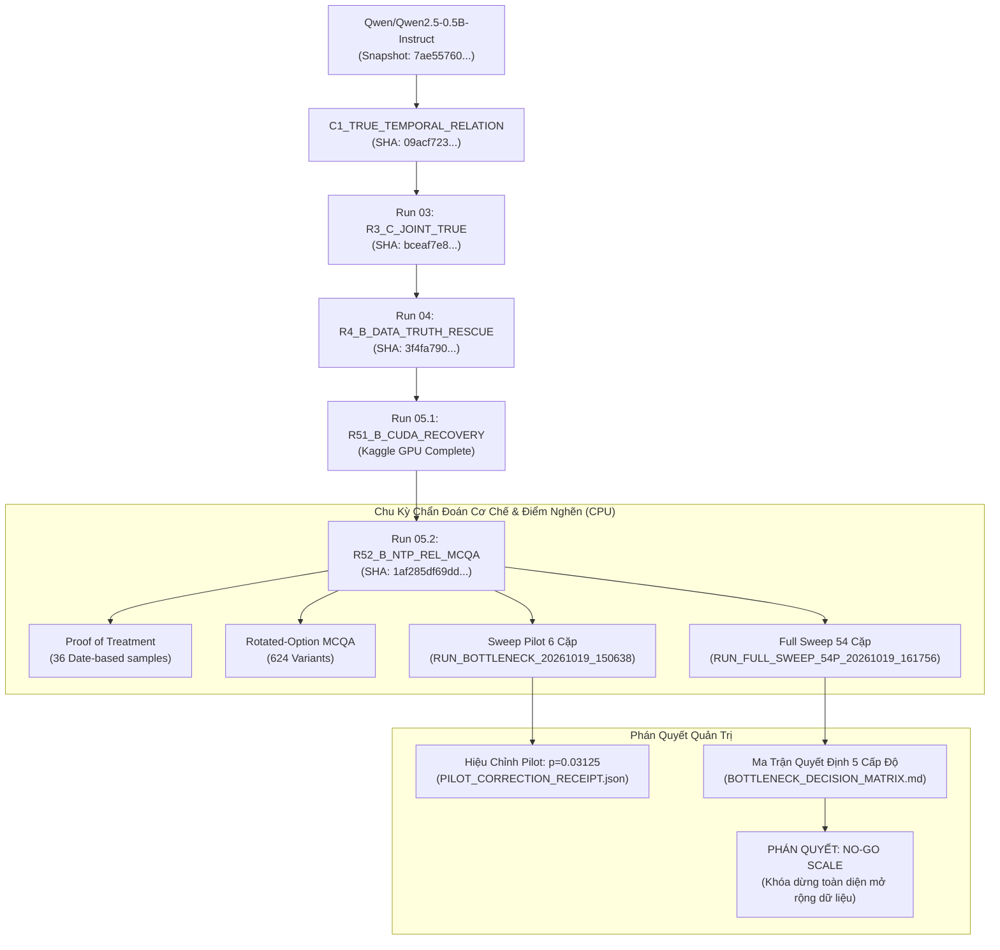

# Dòng Thời Gian và Nguồn Gốc Thực Nghiệm Stage 03 (Stage 03 Run Lineage & Provenance)

**Dự án**: `long-range-temporal-alignment`  
**Giai đoạn**: `STAGE 03 — TARGETED OBJECTIVES & MCQA TRAINING`  
**Nhánh hoạt động**: `v2-targeted-continual-alignment`  
**Cập nhật lần cuối**: `2026-10-20`  
**Mục đích**: Ghi nhận toàn vẹn chuỗi phả hệ thực nghiệm `parent → checkpoint → evaluation protocol → dataset → raw rows → metrics → decision` với mã băm SHA-256 bảo đảm tính tái lập độc lập.

---

## 1. Biểu Đồ Chuỗi Phả Hệ Stage 03

---

## 2. Bảng Kê Chi Tiết Từng Mắt Xích Phả Hệ

### Mắt xích 1: Khởi nguồn Checkpoint Cơ sở (Parent Checkpoints)
- **Mô hình ngôn ngữ nền (Backbone)**:
  - Tên: `Qwen/Qwen2.5-0.5B-Instruct`
  - Snapshot revision: `7ae557604adf67be50417f59c2c2f167def9a775`
  - Trạng thái: Đóng băng tham số $100\%$ (`requires_grad = False`).
- **Checkpoint tiền đề (Parent Checkpoint)**:
  - Tên: `C1_TRUE_TEMPORAL_RELATION` (V2 Run 02)
  - Đường dẫn: `artifacts/experiments/V2_CAUSAL_TEMPORAL_ALIGNMENT/run_02/checkpoints/C1_TRUE_TEMPORAL_RELATION.pt`
  - Mã băm SHA-256: `09acf723ea97401924a070b14775d09584d0a7a565c68d83c71218e814f72cb9`

---

### Mắt xích 2: Huấn luyện Đa nhiệm Run 05.2 trên Kaggle GPU
- **Mã Kernel Kaggle**: `qh0205/lrr-v2-run05-2-mechanism-repair` (Exit Code: 0, Complete).
- **Mục tiêu tối ưu hóa**: $\mathcal{L} = \mathcal{L}_{\text{NTP}} + 0.5 \mathcal{L}_{\text{REL}} + 0.5 \mathcal{L}_{\text{MCQA}}$ (40 optimizer steps, AdamW).
- **Tạo tác Checkpoint Arm B**:
  - Tệp: [`artifacts/experiments/V2_CAUSAL_TEMPORAL_ALIGNMENT/run_05_2/checkpoints/R52_B_NTP_REL_MCQA.pt`](file:///c:/Users/GF63/Documents/long-range-temporal-alignment/artifacts/experiments/V2_CAUSAL_TEMPORAL_ALIGNMENT/run_05_2/checkpoints/R52_B_NTP_REL_MCQA.pt)
  - Kích thước: $30.34\text{ MB}$
  - Mã băm SHA-256: `1af285df69ddaf94d21dcb858e8bd2d5e532874b484131d7fa3a31a4eac41988`
  - Dấu vân tay tensor: `3f4fa790...`
- **Bộ bất biến đối nghịch**: Đạt $20/20$ tests tự động trong `tests/test_run052_contract_invariants.py`.

---

### Mắt xích 3: Giao thức Đánh giá Chuẩn tắc và Bộ Dữ liệu Phản thực nghiệm
- **Giao thức giải mã**: `RAW_GREEDY_V1`
  - `do_sample`: `False`
  - `num_beams`: `1`
  - `repetition_penalty`: `1.0`
  - Không ràng buộc ngữ pháp, không lọc logits.
- **Tập dữ liệu phản thực nghiệm kiểm toán (Grounded Counterfactuals)**:
  - Tệp: [`data/counterfactual/COUNTERFACTUAL_GOLD_AUDIT.jsonl`](file:///c:/Users/GF63/Documents/long-range-temporal-alignment/data/counterfactual/COUNTERFACTUAL_GOLD_AUDIT.jsonl)
  - Mã băm SHA-256 chuẩn tắc: `49eea7fe6fad69d4f3695e7cd8fbeac2c383e65b76d0802801666f9982cdeba5`
  - Quy mô: $54$ cặp ($36$ cặp Gold-Flip, $18$ cặp Gold-Same đối chứng âm; $108$ câu hỏi, $23$ cụm độc lập).
  - Tình trạng thẩm định: `PROGRAMMATIC_VALIDATION_ONLY`.

---

### Mắt xích 4: Đo lường Dữ liệu Thô và Vết Nhân quả (Raw Runs & Metrics)
- **Thực nghiệm quét 54 cặp (`RUN_FULL_SWEEP_54P_20261019_161756`)**:
  - Thời gian thực thi: $781.92$ giây trên CPU ($0$ optimizer steps).
  - Tệp dự đoán thô: [`RAW_PREDICTIONS.jsonl`](file:///c:/Users/GF63/Documents/long-range-temporal-alignment/Reports/03_TARGETED_OBJECTIVES_MCQA/REPRESENTATION_BOTTLENECK/runs/RUN_FULL_SWEEP_54P_20261019_161756/RAW_PREDICTIONS.jsonl) ($432$ bản ghi, SHA-256: `d4f049bb...`).
  - Tệp dấu vết cơ chế: [`MECHANISM_TRACE.jsonl`](file:///c:/Users/GF63/Documents/long-range-temporal-alignment/Reports/03_TARGETED_OBJECTIVES_MCQA/REPRESENTATION_BOTTLENECK/runs/RUN_FULL_SWEEP_54P_20261019_161756/MECHANISM_TRACE.jsonl) ($54$ bản ghi, SHA-256: `6e41bcc9...`).
  - Tệp bảng thống kê: [`PAIRED_STATISTICS.json`](file:///c:/Users/GF63/Documents/long-range-temporal-alignment/Reports/03_TARGETED_OBJECTIVES_MCQA/REPRESENTATION_BOTTLENECK/runs/RUN_FULL_SWEEP_54P_20261019_161756/PAIRED_STATISTICS.json) (SHA-256: `3d342b3d...`).
  - Tệp trạng thái cổng: [`GATES.json`](file:///c:/Users/GF63/Documents/long-range-temporal-alignment/Reports/03_TARGETED_OBJECTIVES_MCQA/REPRESENTATION_BOTTLENECK/runs/RUN_FULL_SWEEP_54P_20261019_161756/GATES.json) (SHA-256: `24bbe9de...`).
  - Chỉ số cơ chế cốt lõi:
    - $\bar{D}_z = 5.317237$ (Delivery PASS)
    - $\bar{D}_F = 0.682921$
    - $\bar{D}_W = 0.500124$ (Delivery PASS)
    - $\Delta_{\text{logits}} = 0.135589$ (Sensitivity PASS)
    - $\text{SelectivityMargin} = 0.016067 < 0.02$ (Selectivity INCONCLUSIVE)
    - Tỷ lệ $\Delta G > 0$: $36.11\%$ (13/36), mean $\bar{\Delta G} = -0.058017$ (No directional gain)
    - $\text{BothCorrect} = 0 / 36 = 0.0\%$ (Semantic Correctness FAIL)
    - Gold-Same Stability: $18 / 18 = 100.0\%$ (kết quả của hiện tượng sụp đổ nhãn All-No).
    - So sánh với Base: Base $56.48\%$ vs Arm B $42.59\%$, Exact McNemar $p = 0.1674$, Clustered McNemar $p = 0.1152$, không có ý nghĩa thống kê.

---

### Mắt xích 5: Quyết định Quản trị Khoa học (Decisions & Writebacks)
- **Văn kiện quyết định**: [`BOTTLENECK_DECISION_MATRIX.md`](file:///c:/Users/GF63/Documents/long-range-temporal-alignment/Reports/03_TARGETED_OBJECTIVES_MCQA/REPRESENTATION_BOTTLENECK/reports/BOTTLENECK_DECISION_MATRIX.md) (SHA-256: `ebd21a6c...`).
- **Sổ cái an toàn nhánh**: [`WRITEBACK_LEDGER.jsonl`](file:///c:/Users/GF63/Documents/long-range-temporal-alignment/Reports/03_TARGETED_OBJECTIVES_MCQA/REPRESENTATION_BOTTLENECK/writebacks/WRITEBACK_LEDGER.jsonl) ghi nhận giao dịch `WB_20261019_002_FULL_SWEEP_54P`.
- **Phán quyết cuối cùng**: **`NO_GO_SCALE`**. Khóa dừng toàn bộ kế hoạch mở rộng tập dữ liệu và huấn luyện GPU quy mô lớn.

---

### Mắt xích 6: Thử Nghiệm Ma Trận Nhân Quả 2x2 và Pháp Y Sụp Đổ Nhãn
- **Đợt chạy khảo sát**: `RUN_STAGE03_POST_ARCHIVE_CAUSAL_20261020_082138`
  - Thời gian thực thi: $732.84$ giây trên CPU ($0$ optimizer steps).
  - Quy mô: $54$ cặp $\times 4$ ô can thiệp $= 216$ lượt suy luận độc lập trên CPU.
  - Tệp dự đoán $2\times 2$: [`RAW_2X2_PREDICTIONS.jsonl`](file:///c:/Users/GF63/Documents/long-range-temporal-alignment/Reports/03_TARGETED_OBJECTIVES_MCQA/REPRESENTATION_BOTTLENECK/runs/RUN_STAGE03_POST_ARCHIVE_CAUSAL_20261020_082138/RAW_2X2_PREDICTIONS.jsonl) ($216$ bản ghi).
  - Tệp đo lường cặp: [`CAUSAL_2X2_PAIR_METRICS.jsonl`](file:///c:/Users/GF63/Documents/long-range-temporal-alignment/Reports/03_TARGETED_OBJECTIVES_MCQA/REPRESENTATION_BOTTLENECK/runs/RUN_STAGE03_POST_ARCHIVE_CAUSAL_20261020_082138/CAUSAL_2X2_PAIR_METRICS.jsonl) ($54$ bản ghi).
  - Tệp thống kê cụm: [`PAIR_CLUSTER_STATS.json`](file:///c:/Users/GF63/Documents/long-range-temporal-alignment/Reports/03_TARGETED_OBJECTIVES_MCQA/REPRESENTATION_BOTTLENECK/runs/RUN_STAGE03_POST_ARCHIVE_CAUSAL_20261020_082138/PAIR_CLUSTER_STATS.json).
  - Chỉ số nhân quả cốt lõi:
    - $E_z(t_1) = -0.0580$, Exact Binomial $p = 0.1325$.
    - $E_z(t_2) = -0.0584$, Exact Binomial $p = 0.1325$.
    - $E_{z\text{\_pair}} = -0.0582$, $95\%$ Clustered Bootstrap CI: $[-0.1478, +0.0442]$.
    - Tỷ lệ $\text{PositiveBothSidesRate} = 13/36 = 36.11\%$ ($95\%$ CI: $[20.44\%, 55.89\%]$).
    - So sánh Text vs Adapter: Text effect magnitude $= 0.0159$ vs Adapter effect magnitude $= 0.2485$.
- **Hệ thống báo cáo pháp y xuất bản**:
  1. [`POST_ARCHIVE_RAW_RECOMPUTATION.md`](file:///c:/Users/GF63/Documents/long-range-temporal-alignment/Reports/03_TARGETED_OBJECTIVES_MCQA/REPRESENTATION_BOTTLENECK/reports/POST_ARCHIVE_RAW_RECOMPUTATION.md): Báo cáo tái tính toán dữ liệu thô, bóc tách All-No collapse và thiên kiến chiều dữ liệu.
  2. [`CAUSAL_TEXT_VS_ADAPTER_LOCALIZATION.md`](file:///c:/Users/GF63/Documents/long-range-temporal-alignment/Reports/03_TARGETED_OBJECTIVES_MCQA/REPRESENTATION_BOTTLENECK/reports/CAUSAL_TEXT_VS_ADAPTER_LOCALIZATION.md): Báo cáo phân tích đối chứng nhân quả $2\times 2$ giữa văn bản câu hỏi và vector biểu diễn.
  3. [`OBJECTIVE_AND_LABEL_COLLAPSE_FORENSICS.md`](file:///c:/Users/GF63/Documents/long-range-temporal-alignment/Reports/03_TARGETED_OBJECTIVES_MCQA/REPRESENTATION_BOTTLENECK/reports/OBJECTIVE_AND_LABEL_COLLAPSE_FORENSICS.md): Báo cáo giải phẫu hàm mục tiêu huấn luyện và cơ chế gradient overshooting.
  4. [`NEXT_SINGLE_VARIABLE_DECISION.md`](file:///c:/Users/GF63/Documents/long-range-temporal-alignment/Reports/03_TARGETED_OBJECTIVES_MCQA/REPRESENTATION_BOTTLENECK/reports/NEXT_SINGLE_VARIABLE_DECISION.md): Báo cáo khóa ranh giới module hoán vị lựa chọn và nguyên tắc can thiệp một biến.
- **Trạng thái cổng hiện hành**: `NO_GO_SCALE`, `GO_CPU_DIAGNOSTIC`, `ALTERNATIVE_OBJECTIVE_PROPOSAL_ONLY`.

---

### Mắt xích 7: Chuẩn Bị Chuyển Dịch Sang Qwen2.5-3B-Instruct (PRE_3B_READY)
- **Động lực thực nghiệm**: Tiếp thu chỉ đạo định hướng của GVHD (20/10/2026) nhằm kiểm chứng giả thuyết dung lượng mô hình (Capacity-Scale Hypothesis), loại trừ khả năng các điểm nghẽn tại Stage 03 bắt nguồn đơn thuần từ giới hạn dung lượng của mô hình 0.5B.
- **Mô hình mục tiêu**:
  - Tên: `Qwen/Qwen2.5-3B-Instruct` (Revision Hub: `aa8e72537993ba99e69dfaafa59ed015b17504d1`).
  - Kiến trúc: 36 transformer layers, $d_{\text{model}} = 2048$, $d_{\text{intermediate}} = 11008$, 16 query heads, 2 KV heads, từ vựng 151.936 tokens.
  - Tổng số module LoRA: 108 module MLP (36 layers $\times$ 3 projections).
  - Vị trí cổng Seam: Tầng 21/36 ($\approx 0.5833$, đồng cấu với Tầng 14/24 của 0.5B).
- **Ràng buộc bất biến tuyệt đối**:
  - Bảo tồn dữ liệu: Giữ nguyên tập dữ liệu gốc, không xáo trộn/chỉnh sửa hay tái tạo dữ liệu, tuyệt đối không hoán vị phương án đáp án (`OnlineOptionPermutation.enabled = False` locked).
  - Zero Cross-Scale Weight Loading: Cấm tuyệt đối nạp chéo trọng số LoRA hay Seam 0.5B sang 3B.
- **Tiền đăng ký ma trận cắt bỏ 5 cánh tay**: `Q3_A0` (Base 3B Freeze), `Q3_A1` (Static LoRA 3B), `Q3_A2` (Static LoRA + Seam L21), `Q3_A3` (Dynamic Core MaT-LoRA 3B), `Q3_A4` (Joint Causal Multi-task).
- **Trạng thái cổng và điểm dừng bắt buộc**:
  - Trạng thái: **`PRE_3B_READY`** (14/15 cổng PASS, G11 NOT_VERIFIED chờ tải weights).
  - Rào chắn: **`NO_GO_LARGE_TRAINING`** (0 byte weight downloaded, 0 GPU allocated, 0 training run).
  - Thư mục hồ sơ tạo tác: [`Reports/03_TARGETED_OBJECTIVES_MCQA/QWEN25_3B_TRANSITION/`](file:///c:/Users/GF63/Documents/long-range-temporal-alignment/Reports/03_TARGETED_OBJECTIVES_MCQA/QWEN25_3B_TRANSITION/).

