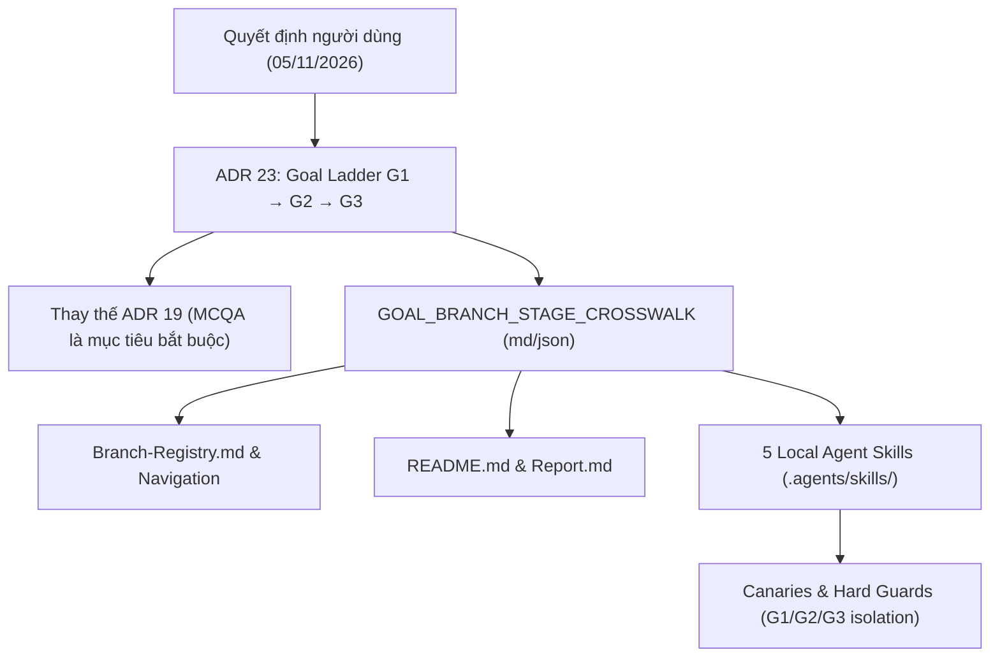

# Báo Cáo Thay Đổi Ngữ Cảnh và Đồng Bộ Dải Mục Tiêu (Before-After Context Diff)

**Ngày thực hiện:** 05/11/2026  
**Dự án:** `long-range-temporal-alignment`  
**Chủ thể phê duyệt thẩm quyền:** Người dùng (Chủ nhiệm đề tài) + ChatGPT (Cố vấn phương pháp)  
**Đơn vị thực thi kỹ thuật:** Antigravity (Executor / Auditor / Documentation maintainer)  
**Nhánh hoạt động:** `ACTIVE_BRANCH=GLOBAL_MAINTENANCE`  
**Khế ước quản trị tối cao:** [ADR 23: GOAL LADDER AND ACCEPTANCE](file:///c:/Users/GF63/Documents/long-range-temporal-alignment/Documents/Decision-Making/23_GOAL_LADDER_AND_ACCEPTANCE_20261105.md)

---

## 1. Tóm Lược Thay Đổi Ngữ Cảnh (Executive Diff Summary)

Đợt đồng bộ này chuẩn hóa toàn diện mối quan hệ giữa các mục tiêu khoa học cấp cao và toàn bộ hạ tầng tài liệu, điều phối nhánh và agent skills của đề tài. Mọi tài sản khoa học lịch sử (raw data, model checkpoints, forensic receipts) được giữ nguyên vẹn 100% không suy suyển.



---

## 2. Bảng Đối Chiếu Chi Tiết Trước và Sau Thay Đổi (Before-After Matrix)

| Tệp / Thành Phần | Trạng Thái Trước Thay Đổi (Before) | Trạng Thái Sau Thay Đổi (After) | Bản Chất Thay Đổi Kỹ Thuật |
| :--- | :--- | :--- | :--- |
| `Documents/Decision-Making/23_GOAL_LADDER_AND_ACCEPTANCE_20261105.md` | Chưa tồn tại | Tạo mới, đã ingest vào Living Knowledge Vault | Thiết lập Nguồn Chân lý Duy nhất (SSOT) cho Goal 1, Goal 2, Goal 3; quy định 6 thực thể định danh và transition gates. |
| `Documents/Decision-Making/19_STAGE03_REPRESENTATION_FIRST_CONTRACT.md` | `trạng_thái: "đang-dùng"`, `chuẩn_hiện_hành: true`. MCQA bị coi là probe phụ. | `trạng_thái: "bị-thay-thế"`, `chuẩn_hiện_hành: false`, `bị_thay_thế_bởi: ["[[23...]]"]`. Bổ sung cảnh báo supersede. | Chuyển trạng thái sang bị thay thế một phần; công nhận độ chính xác đáp án đóng là kết quả bắt buộc của Goal 1. |
| `Documents/Global/GOAL_BRANCH_STAGE_CROSSWALK.md` | Chưa tồn tại | Tạo mới | Ma trận ánh xạ toàn diện giữa GOAL_ID (G1, G2, G3) với các Branch, Stage, Arm, Claim scope, Evidence status và Next gate. |
| `Documents/Global/GOAL_BRANCH_STAGE_CROSSWALK.json` | Chưa tồn tại | Tạo mới chuẩn JSON-Schema | Cung cấp định dạng máy đọc cho các công cụ CI/CD, agent hooks và automated auditors. |
| `Documents/Global/Branch-Registry.md` | Chỉ có Branch ID, Trọng tâm, Trạng thái, Parent, State pointer, Gate | Bổ sung cột `Mục tiêu (GOAL_ID)` và liên kết tới ADR 23 / Crosswalk | Định tuyến rõ `v1` là anchor G1; `v2` đang phục vụ G1; G2 và G3 chưa kích hoạt trên nhánh nào. |
| `Documents/HOME/Trang chủ.md` | Phiên bản cũ (2026-09-06), chỉ liệt kê các ADR ban đầu | Cập nhật mục tiêu ba tầng G1/G2/G3, bổ sung ADR 23 và Crosswalk | Đồng bộ cổng điều hướng tri thức vault gốc. |
| `Documents/HOME/Bản đồ tri thức.md` | Phiên bản cũ (2026-09-06) | Bổ sung ADR 23 và liên kết Crosswalk | Đảm bảo sơ đồ liên kết tri thức không bị mồ côi. |
| `Documents/Documenting/RULE.md` | Chỉ quy định chung về ghi chép báo cáo | Bổ sung mục "Quy tắc gắn nhãn và chuẩn hóa theo Goal Ladder" | Bắt buộc gắn nhãn `GOAL1_YEAR_CLOSED_ANSWER` cho tài liệu Stage 03; cấm overclaim sang G2/G3; giữ nhãn `METRIC_ARITHMETIC_ONLY`. |
| `README.md` | Mô tả chung về hỏi đáp lịch sử Việt Nam | Bổ sung mục "Khung Mục Tiêu Nghiên Cứu Ba Tầng (Goal Ladder)" | Công khai lộ trình G1, G2, G3 và tiêu chuẩn nghiệm thu câu trả lời đóng. |
| `Report.md` | Bảng hai track rời rạc | Kết nối Track A (Retrieval) và Track B (Representation) trực tiếp vào từng nấc G1, G2, G3 | Định vị rõ Track B giải quyết G1/G2; Track A+B hợp nhất giải quyết G3. |
| `.agents/skills/temporal-alignment-research/SKILL.md` | Quy trình chung | Bổ sung kiểm tra bắt buộc `goal_id`; phân loại biểu diễn là MECHANISM, không phải GOAL_GAIN | Ngăn chặn việc ngộ nhận logit shift là cải tiến mục tiêu. |
| `.agents/skills/temporal-research-planning/SKILL.md` | Lập kế hoạch tự do | Bổ sung ràng buộc `HOLD_NO_GO_TRAINING` và thử nghiệm đơn biến | Không mở GPU run mới khi chưa replay Goal 1. |
| `.agents/skills/project-context-router/SKILL.md` | Điều hướng theo path | Điều hướng ưu tiên qua ADR 23 và Crosswalk trong ngân sách token hẹp | Định tuyến ngữ cảnh chính xác, tránh đọc tràn lan. |
| `.agents/skills/project-change-verification/SKILL.md` | Verification cơ bản | Bổ sung 3 Canaries: cấm claim G2 trên tập năm, cấm claim G3 khi thiếu gold open QA, giữ kiểm dịch Stage 03 | Rào chắn deterministic ngăn chặn sai phạm phương pháp. |
| `.agents/skills/project-knowledge-writeback/SKILL.md` | Ghi nhận chung | Bổ sung quy tắc cấm nâng hạng `5epochs` thành Goal 1 success khi chưa có GPU replay | Đảm bảo tính trung thực và liêm chính của tri thức ghi lại. |

---

## 3. Nhật Ký Kiểm Thử và Xác Minh Độc Lập (Verification Receipts)

Mọi thay đổi đều đã vượt qua 100% các công cụ kiểm tra tự động của repository:

1. **Kiểm tra Living Knowledge Vault:**
   ```powershell
   .venv\Scripts\python.exe scripts/validate_knowledge_vault.py
   # Kết quả: Living Knowledge Vault: PASS (107 Markdown, 44 managed, 16 decisions, 12 references)
   ```

2. **Kiểm tra Cấu Trúc Toàn Dự Án:**
   ```powershell
   .venv\Scripts\python.exe scripts/validate_project.py
   # Kết quả: VALIDATION PASSED: 66 required files, 10 DOCX/source pairs, progress HTML, smoke pipeline
   ```

3. **Kiểm tra Pipeline Unit Tests:**
   ```powershell
   .venv\Scripts\python.exe -m pytest tests/test_pipeline.py -q
   # Kết quả: 1 passed in 0.06s
   ```

4. **Kiểm tra Tính Toàn Vẹn Tài Sản Khoa Học:**
   - 51 tài sản (bao gồm 12 adapter checkpoints, 7 file JSON forensic, các bảng kết quả đo và dữ liệu) được kiểm tra mã băm SHA-256 bất biến tại `UNMODIFIED_SCIENTIFIC_ARTIFACTS.json`.

---

## 4. Kết Luận Quản Trị

Toàn bộ hệ thống tài liệu và công cụ điều hướng của dự án hiện đã đồng nhất 100% với định hướng nghiên cứu mới:
- **Goal 1** là mục tiêu đóng duy nhất đang hoạt động và đang được kiểm định chặt chẽ.
- **Goal 2** và **Goal 3** được bảo vệ bởi các rào chắn kiểm soát (Canaries & Hard Guards), loại trừ hoàn toàn nguy cơ công bố sai lệch hoặc đánh tráo khái niệm.
