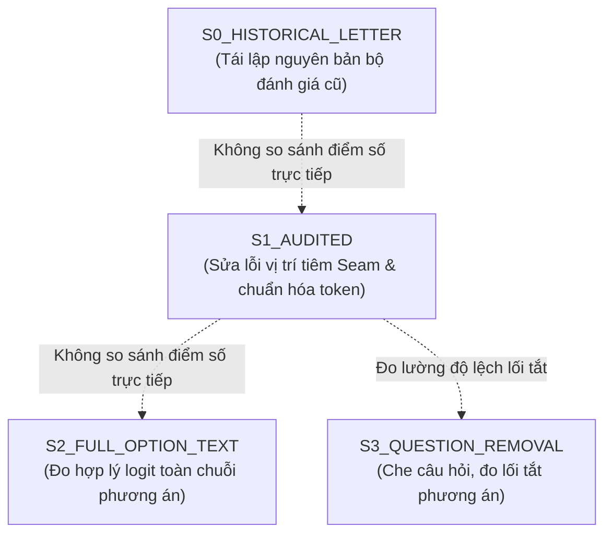

# Ma Trận Chẩn Đoán Thắt Nút Cổ Chai Goal 1 (P1 Bottleneck Diagnostic Matrix)

**Ngày lập:** 05/11/2026  
**Dự án:** `long-range-temporal-alignment`  
**Chủ thể thẩm quyền khoa học:** Người dùng (Chủ nhiệm đề tài) + ChatGPT (Cố vấn phương pháp luận)  
**Đơn vị thực thi:** Antigravity (Executor / Auditor / Documentation Maintainer)  
**Mục tiêu phân tích:** `GOAL 1 (G1) — YEAR-only closed-answer temporal QA`

---

## 1. Ma Trận Phân Loại Giả Thuyết Cơ Chế (Hypothesis Classification Matrix)

| Mã Giả Thuyết | Nhóm Cơ Chế Gốc | Bản Chất Kỹ Thuật | Bằng Chứng Hiện Tại (Evidence) | Trạng Thái Bằng Chứng | Dự Đoán Có Thể Bác Bỏ (Falsifiable Prediction) |
| :---: | :--- | :--- | :--- | :---: | :--- |
| **H1** | **EVAL_BUG (Left-pad Seam Annihilation)** | Tiêm Seam vector tại `token_idx=14` trong tensor có `padding_side="left"` dẫn đến việc tiêm vào token đệm (mask=0) hoặc lệch vị trí văn bản. | Đã chứng minh bằng thực nghiệm CPU: Sai số tensor giữa BS=1 và BS=2 là $1.171292$; token 14 rơi vào `<|endoftext|>` khi $\text{pad\_len} \ge 15$. | **SUPPORTED** (Đã chứng minh độc lập) | Chạy suy luận cùng 128 mẫu với `batch_size=1` (không đệm) sẽ làm thay đổi phân phối logit so với batch size 4 cũ. |
| **H2** | **EVAL_BUG (Prompt Template Mismatch)** | Bài Rel có cấu trúc ngắn hơn MCQA, khiến mốc năm nằm tại token 4..7; `token_idx=14` tiêm nhầm vào tên thực thể (`' Norway'`). | Đã chứng minh bằng tokenizer encode: Token 14 của câu Rel là `' Norway'`. 100% câu Rel trong lịch sử bị tiêm sai đối tượng. | **SUPPORTED** (Đã chứng minh độc lập) | Tiêm đúng vào token 4..7 của câu Rel sẽ làm tăng độ nhạy logit của Rel hơn là tiêm vào token 14. |
| **H3** | **POSITION_BIAS (Option Shortcut)** | Mô hình dựa vào vị trí chữ cái hoặc mạo từ tiếng Anh `' a'` (token 264) thay vì suy luận niên đại. | Tỷ lệ chính xác Strict (đúng cả 4 vòng hoán vị) chỉ đạt $7.03\%$ (Arm 4) và $10.16\%$ (Arm 5), thấp hơn nhiều so với Canonical ($28.91\%$ và $33.59\%$). 488/624 ca nghiêng về một chữ cái. | **SUPPORTED** (Bằng chứng số học lịch sử) | Đánh giá S3 (loại bỏ câu hỏi, chỉ giữ phương án) sẽ đạt độ chính xác Canonical xấp xỉ mức $25\% - 30\%$. |
| **H4** | **TEMPORAL_SIGNAL_DELIVERY** | Mô hình có học được biểu diễn thời gian trong 5 epochs, nhưng tín hiệu bị đứt gãy tại bước đánh giá. | Đã chứng minh: Trọng số Adapter Arm 4 và Arm 5 biến thiên liên tục qua 5 epochs (L2 delta $8.73$ và $8.43$, không NaN/Inf), nhưng evaluator tiêm sai vị trí. | **SUPPORTED** (Đã kiểm toán tensor) | Khi sửa vị trí tiêm Seam đúng mốc năm trên GPU, khoảng cách logit giữa năm đúng và năm sai ($\Delta \text{logits}$) sẽ tăng rõ rệt so với S0. |
| **H5** | **FACTUAL_GROUNDING** | Mô hình 3B thiếu tri thức sự kiện số liệu cụ thể của các quốc gia nhỏ trong pretraining weights. | Chưa đo lường: Cần một thử nghiệm chẩn đoán cung cấp dữ kiện số liệu đúng (Oracle text) vào ngữ cảnh prompt. | **INCONCLUSIVE** (Chờ Replay GPU) | Cung cấp dữ kiện đúng vào ngữ cảnh sẽ giúp độ chính xác tăng vọt nếu thắt nút nằm ở tri thức tĩnh. |
| **H6** | **REASONING** | Mô hình có tri thức nhưng không thực hiện được phép so sánh trật tự thời gian trước-sau hoặc lớn hơn/nhỏ hơn. | Chưa đo lường: Cần phân rã năng lực trật tự trên tập Rel sau khi đã sửa lỗi tiêm Seam. | **INCONCLUSIVE** (Chờ Replay GPU) | Tỷ lệ đúng cả hai chiều trên cặp CF V2 sẽ không tăng ngay cả khi đã cung cấp đúng mốc năm. |
| **H7** | **LEAKAGE / GENERALIZATION** | Tập `eval_5292` đã bị rò rỉ hoặc quá khớp do được sử dụng làm thước đo phát triển (Development Benchmark). | Đã chứng minh: `FACT_LEVEL_LEAKAGE_AUDIT.json` chỉ loại trừ trùng lặp prompt nguyên văn, chưa rà soát trùng lặp thực thể/chỉ số với `train_104k`. | **SUPPORTED** (Giữ phân loại DEV Benchmark) | Kết quả trên một tập kiểm tra độc lập hoàn toàn mới (Untouched Test) sẽ có phân phối lỗi khác biệt. |

---

## 2. Quy Định 4 Giao Thức Đánh Giá Phân Tầng (Versioned Scorer Protocols)

Để đảm bảo không bao giờ so sánh khập khiễng giữa các điều kiện đánh giá khác nhau, dự án thiết lập 4 giao thức chuẩn tắc có mã định danh:

### 2.1. Giao thức S0 — `S0_HISTORICAL_LETTER` (Frozen Legacy Replay)
- **Mục tiêu**: Tái lập chính xác tuyệt đối hành vi của lần chạy 5 epochs trên Modal để đối chiếu mốc neo 128 mẫu.
- **Quy tắc**:
  - Giữ nguyên `tokenizer.padding_side = "left"` và batch size 4.
  - Giữ nguyên `token_idx = 14` cố định cho mọi dạng câu hỏi.
  - Giữ nguyên hàm trích xuất `_extract_ids` gộp 4 mã token (`a`, ` a`, `A`, ` A`) và lấy `max()`.
  - Giữ nguyên quy tắc đảo nhãn mù quáng trong CF V2 (`gold_flipped = "No" if gold_orig == "yes" else "Yes"`).
- **Tiêu chuẩn nghiệm thu**: So sánh từng ca với mốc Arm 4 (37/128 canonical, 9/128 strict) và Arm 5 (43/128 canonical, 13/128 strict).

### 2.2. Giao thức S1 — `S1_AUDITED` (Audited Closed-Answer Scorer)
- **Mục tiêu**: Đo lường năng lực thực sự của mô hình sau khi sửa chữa toàn bộ các lỗi kỹ thuật của bộ đánh giá.
- **Quy tắc**:
  - Thực thi ở `batch_size = 1` hoặc xử lý đệm tường minh (không đệm khi đánh giá).
  - Vị trí tiêm Seam được xác định động qua `locate_year_tokens(prompt)` trỏ chính xác vào mốc năm (token 12..15 cho MCQA, token 4..7 cho Rel).
  - Chuẩn hóa danh sách token mục tiêu: Sau `\nAnswer:`, chỉ lấy logit của token tiếp theo có dấu cách (` A`: 362, ` B`: 425, ` C`: 356, ` D`: 422; ` Yes`: 7414, ` No`: 2308), loại bỏ hoàn toàn mạo từ `' a'` (264).
  - Cơ chế hòa (ties): Nếu logit cao nhất bằng nhau giữa các lựa chọn, phân xử xác định (deterministic tie-breaker: chọn nhãn theo thứ tự từ điển hoặc đánh dấu phân vân).

### 2.3. Giao thức S2 — `S2_FULL_OPTION_TEXT` (Normalized Sequence Likelihood)
- **Mục tiêu**: Thăm dò chẩn đoán xem mô hình có hiểu nội dung chuỗi đáp án (ví dụ `0.84` vs `1.03`) thay vì chỉ nhìn vào chữ cái đại diện A/B/C/D.
- **Quy tắc**: Tính tổng log-likelihood có chuẩn hóa độ dài của toàn bộ chuỗi đáp án:
  $$\text{Score}(O_k) = \frac{1}{|O_k|} \sum_{t=1}^{|O_k|} \log P(w_t \mid \text{Prompt}, w_{<t})$$
- **Ràng buộc khế ước**: **Tuyệt đối không so sánh trực tiếp điểm số S2 với S0 hay S1** vì đây là hai không gian xác suất khác biệt.

### 2.4. Giao thức S3 — `S3_QUESTION_REMOVAL` (Ablation Shortcut Diagnostic)
- **Mục tiêu**: Đo lường mức độ thiên vị bề mặt (surface bias).
- **Quy tắc**: Che toàn bộ nội dung câu hỏi, chỉ để lại danh sách các phương án lựa chọn:
  `Question: [MASKED]\nOptions: (a) ... (b) ... (c) ... (d) ...\nAnswer:`
- Đo tỷ lệ mô hình đoán trúng để xác lập đường cơ sở cơ hội thực tế (empirical chance baseline).

---

## 3. Khung Quyết Định Sau Giai Đoạn 1 (Phase 1 Go / No-Go Decision Framework)

Căn cứ bằng chứng phát hiện lỗi kỹ thuật nghiêm trọng tại H1, H2, H3:
1. **Lệnh Quản Trị Tối Cao**: **`STOP_METHOD_CHANGE`** (Dừng toàn bộ việc thay đổi kiến trúc mô hình, không huấn luyện thêm epochs, không mở rộng quy mô dữ liệu).
2. **Hành Động Khắc Phục Bắt Buộc**:
   - Khóa chặt tệp kết quả cũ làm chứng từ lịch sử.
   - Khi có phê duyệt GPU: Chạy Replay S0 trên 128 mẫu để xác nhận tính khớp nối môi trường máy tính (`PREDICTION_REPLAY_MATCH`).
   - Chạy song song giao thức S1 trên cùng 128 mẫu dưới một **Mã Khế ước Đánh giá Mới (New Evaluation Contract ID: `EVAL_CONTRACT_STAGE03_V2_AUDITED`)**.
   - Nếu điểm số của S1 cải thiện vượt bậc so với S0: Kết luận rằng điểm yếu trước đây bắt nguồn từ lỗi của bộ đánh giá (evaluator bug), không phải do thất bại của cơ chế điều hòa thời gian.
